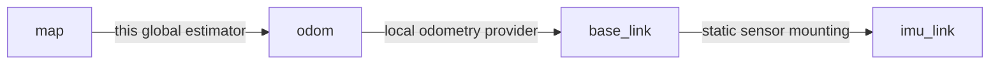

# Autoware / Nav2 6DoF integration

The development target is one ROS-independent 15-error-state ESKF with
position, velocity, quaternion attitude and IMU biases, plus integration
profiles for Autoware and Nav2. Six degrees of freedom means estimating
`x/y/z/roll/pitch/yaw` together, including uncertainty and correlations.
Planar constraints remain optional vehicle-specific observations.

See [stack launch and activation](stack_launch.md) for executable Autoware and
Nav2 entry points, service behavior, topic remappings and startup requirements.

This is an implementation roadmap and interface reference. The package is **not
yet a complete drop-in replacement** for Autoware's EKF localizer. Autoware and
Nav2 end-to-end navigation have not been validated in this repository.

## Shared outputs

The following outputs are published with the same state and timestamp:

| Default topic | Type | Frame |
|---|---|---|
| `/ekf_localization/current_pose` | `geometry_msgs/PoseStamped` | reference (`map`) |
| `/ekf_localization/current_pose_with_covariance` | `geometry_msgs/PoseWithCovarianceStamped` | reference |
| `/ekf_localization/current_twist` | `geometry_msgs/TwistStamped` | body (`base_link`) |
| `/ekf_localization/current_twist_with_covariance` | `geometry_msgs/TwistWithCovarianceStamped` | body |
| `/ekf_localization/current_odometry` | `nav_msgs/Odometry` | reference, child = body |

Use standard ROS remappings to connect these outputs. Standalone Pose/Twist
messages copy their values and covariances from the same Odometry message.
`output_qos_depth` applies to all these outputs.

Pose covariance is ordered `[x, y, z, rotation_x, rotation_y, rotation_z]`, with
fixed reference-frame rotation axes (ROS convention). The ESKF's attitude error
is right-multiplicative in the body tangent. Export uses
`J = diag(I, R_world_body)` on the position/attitude subspace and preserves the
position-attitude cross covariance.

Twist is ordered `[vx, vy, vz, wx, wy, wz]` in the body frame. Linear covariance
includes attitude uncertainty and state correlations through the Jacobian of
`R.transpose() * v_world`. Angular velocity is the latest accepted body-frame
IMU rate minus estimated gyro bias. Its covariance includes rotated IMU sample
covariance and gyro-bias uncertainty, using the independent-current-sample
approximation. A zero/invalid/unavailable IMU covariance is represented by a
conservative `1e6 rad²/s²` diagonal, not zero uncertainty. This is a sampled gyro
output, not an independently smoothed angular-rate state.

## Nav2 TF ownership

The normal navigation tree separates continuous local odometry from global
corrections:



The package's existing `publish_tf: false` default is unchanged. Choose one
TF mode when enabling it:

| Setting | Published edge | Other provider required |
|---|---|---|
| `tf_output_mode: reference_to_base` (default) | reference → body | No competing body-parent TF |
| `tf_output_mode: reference_to_odom` | reference → `odom_frame_id` | odom → body |

For the global Nav2 role, use these parameter overrides alongside the actual
sensor configuration:

```yaml
ekf_localization:
  ros__parameters:
    reference_frame_id: map
    odom_frame_id: odom
    robot_frame_id: base_link
    output_stamp_source: imu
    output_publish_mode: imu
    publish_tf: true
    tf_output_mode: reference_to_odom
    use_flat_ground: false
```

The estimator composes `map<-odom = (map<-base) * inverse(odom<-base)` at the
**same sensor timestamp**. It waits without blocking for delayed local TF,
retaining at most 200 global poses, and publishes the newest composable pose
with that pose's timestamp. Missing local TF suppresses the global TF output
and emits a throttled warning; it does not fabricate an identity transform.
Large TF delays can exhaust the queue; configure the local provider's rate and
navigation transform tolerance accordingly. This delay compensation concerns
TF composition, not the separate sensor measurement replay mechanism.

The local provider owns the sole `odom->base_link` edge. Do not run AMCL or
another global estimator publishing a competing `map->odom` edge. The global
Odometry message still has `header.frame_id=map`; Nav2 controller odometry must
come from the continuous local provider, not this globally corrected topic.
Nav2's standard planners/costmaps generally operate in 2D: a 6DoF state estimate
does not by itself make Nav2 a 3D navigation stack.

## Autoware replacement contract

The compatibility reference is the official
[autoware_core EKF localizer at e9ce57bb](https://github.com/autowarefoundation/autoware_core/tree/e9ce57bb47ebad82642f09594b8e97712d1893c8/localization/autoware_ekf_localizer),
inspected on 2026-10-24. Its documented prediction model is planar, with separate
vertical/roll/pitch handling. Our replacement target keeps its external contract
while integrating a genuine 6DoF inertial model internally.

Core input contracts and remaining work:

- `measured_pose_with_covariance`: [implemented optional pose input](pose_measurements.md)
  with correlated 6DoF covariance, timestamped frame conversion, delay replay and
  joint NIS gating and an independent freshness watchdog. Pose quarantine remains pending.
- `measured_twist_with_covariance`: [implemented linear velocity input](twist_measurements.md),
  with extrinsic/origin transport, correlated covariance, delay replay and NIS
  gating. Angular rates propagate through the IMU and are not fused twice.
  Partial source-axis selection is supported; joint angular observations remain pending.
- `initialpose`: [full correlated initialization](initialization_reset.md) is
  implemented with reference-frame conversion and atomic rejection. Diagonal
  fallback remains the default for legacy callers. The generic reset service
  clears histories and waits for a new seed/IMU. The SetBool activation gate and
  launch mapping are implemented; repeated activation is deliberately idempotent.
- Main Pose/Twist/Odometry launch remappings and SetBool activation are implemented.
  Full diagnostics/parameter/QoS parity and pipeline operation remain to validate.

The current output topics can be remapped to `ekf_pose`,
`ekf_pose_with_covariance`, `ekf_twist`, `ekf_twist_with_covariance` and `ekf_odom`.
That output mapping alone is not drop-in compatibility. Yaw-bias-specific
outputs remain pending. Activation differences are documented explicitly.

## Development gates

1. **Shared output/TF foundation:** finite-difference checks for full 6DoF output
   Jacobians; PSD/correlation checks; real ROS messages with nonzero roll/pitch,
   height and three-axis angular rate; delayed Nav2 TF composition.
2. **Measurement fusion:** joint 6DoF absolute pose input is implemented with
   covariance/frame conversion, timestamp replay and outlier handling. Twist
   linear velocity observations, source-axis selection, correlated initialization,
   generic reset and Pose freshness are implemented. Source quarantine and a
   correlated angular-rate measurement model remain. Position-only GNSS stays
   a separate input model.
3. **Integration profiles:** executable Autoware/Nav2 global launches and activation
   gate are implemented. Validate full stack diagnostics/QoS, local odometry
   integration, startup, reset and loss/recovery behavior in navigation scenarios.
4. **Scenario regression:** slopes, banked turns, uneven terrain, nontrivial
   sensor mounting/lever arms, outages, delayed/reordered data and frame changes.
   Evaluate 3D position and geodesic attitude error, consistency and runtime.
5. **Stack validation and hero:** representative Autoware and Nav2 simulation
   workflows, then a 3D hero illustrating verified behavior and measured errors.

The [6DoF hero](../demos/hero_6dof/README.md) now covers a synthetic spatial
component scenario using the real integration launch: banked turns, varying
height, rotated IMU mounting, delayed poses and a 12 s pose outage. Its physical
input and output/error gates pass. The previous planar hero remains reproducible.
A [real Odaiba regression demo](../demos/real_data_hero/README.md) also replays
measured IMU/wheel data and independently processed rover GNSS with planar
constraints disabled. Its initialization/frame assumptions and all measured errors
are disclosed; it is not the registered blind holdout.
Full Autoware/Nav2 navigation and public real-data holdouts remain required before
stack compatibility or general accuracy claims.

## Checks

After a normal colcon build and sourcing the install space:

```bash
colcon test --packages-select kalman_filter_localization_core \
  --ctest-args -R test_state_output
colcon test --packages-select kalman_filter_localization \
  --ctest-args -R test_state_output_ros
colcon test-result --verbose
```

The ROS test launches the actual estimator process. It streams a tilted,
rotating IMU through a non-identity mounting transform, checks published
pose/twist covariance and angular rates, and deliberately delays local odometry
TF. The TF assertion reconstructs the body pose from both edges at every
published timestamp. These checks cover the shared foundation, not full
Autoware/Nav2 stack operation.

Validation on 2026-10-24 (ROS 2 Jazzy): all three packages built; `colcon
test-result` reported 365 tests, 0 errors, 0 failures and 32 skipped. Coverage
includes output covariance, known/unknown IMU noise, delayed TF composition,
joint pose and linear Twist fusion/replay, source-origin transport, Pose
freshness/recovery, partial velocity axes, correlated initialization, reset
with dynamic TF cache clearing, startup time boundaries, activation cycles
and namespaced Autoware/Nav2 launch remappings. Skipped checks are not counted as executed functional coverage. These are component-level checks; complete
Autoware/Nav2 navigation remains a separate gate.
